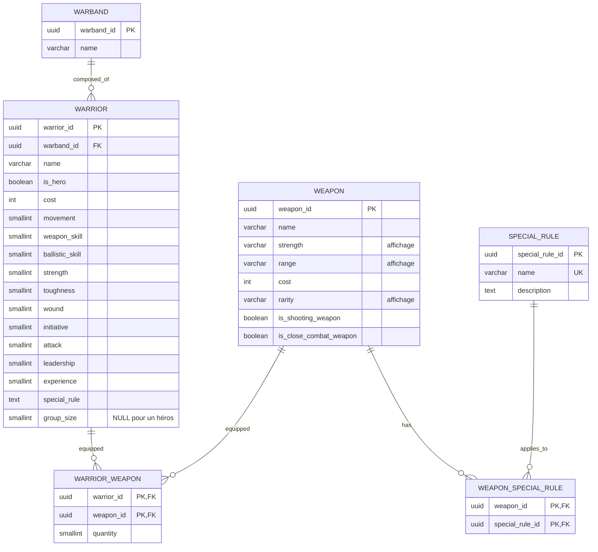

# Mordheim Builder : document de conception

> Ce document récapitule les décisions prises, **et surtout leurs raisons**. Il sert de support pour expliquer le projet en entretien. Chaque choix est présenté avec ses alternatives et ses compromis.

Légende de statut utilisée dans le document :
- **Décidé et réalisé** : présent dans le dépôt.
- **Décidé, à implémenter** : choix arrêté, code pas encore écrit.
- **Piste envisagée** : idée discutée, non tranchée.

---

## 1. Contexte et objectifs

**Objectif du projet** : un utilitaire web gratuit de création de liste d'armée pour des jeux Games Workshop considérés comme abandonnés, en commençant par **Mordheim**.

**Objectif personnel** : monter en compétences sur un cas concret, avec une architecture soignée, pour étayer des candidatures. Le projet est donc volontairement construit comme un vrai produit (migrations versionnées, séparation domaine/infrastructure, tests ciblés) plutôt que comme un simple CRUD.

**Périmètre du POC** : récupérer une bande (avec ses guerriers et leur équipement) de bout en bout : base de données, API, interface. Accès **anonyme**, sans compte, sans enregistrement. Les fonctionnalités sont ajoutées **par lots**.

### Pourquoi Mordheim ?
- Jeu sans nouvelle édition ni support officiel actif, contrairement à d'autres jeux GW relancés récemment.
- Communauté encore active, outils existants souvent vieillissants.
- Règles riches : progression de personnage, contraintes de composition de bande, équipement avec règles d'exclusion, règles spéciales. C'est un vrai **moteur de règles** à concevoir, pas juste un additionneur de points.

### Propriété intellectuelle
« Abandonné » ne signifie pas « libre de droits ». Précautions retenues :
- projet **gratuit et non monétisé**, présenté comme **non officiel et non affilié** à Games Workshop ;
- aucun logo, illustration ou asset officiel ;
- éviter les marques dans le nom du projet ;
- données de règles saisies par l'auteur à partir de ses propres notes (zone grise reconnue) ;
- séparer le **moteur de règles** du **contenu de règles** (le contenu est dans des migrations de seed, donc facile à retirer ou réécrire).

---

## 2. Stack technique

| Couche | Choix | Statut |
|---|---|---|
| Base de données | PostgreSQL, modèle **full relationnel** | Réalisé |
| Migrations | **Flyway** (scripts SQL versionnés) | Réalisé |
| Environnement local | Docker Compose (PostgreSQL 16) | Réalisé |
| Backend | Java 17, Spring Boot, JPA, **architecture hexagonale stricte** | À implémenter |
| Frontend | Angular 20, **Signals**, composants standalone, **NgRx** (pour la formation) | À implémenter |

### Pourquoi du relationnel pur ?
Le domaine est naturellement relationnel (bande → guerriers → équipement → règles). Clés étrangères et intégrité référentielle collent bien. JSONB reste possible pour des cas atypiques, mais **en exception, pas en réflexe** (voir §4.3).

---

## 3. Architecture hexagonale (cible)

**Statut : décidé, à implémenter.**

### Le principe
Le **domaine** (règles du jeu) ne dépend de rien : ni Spring, ni JPA, ni HTTP. Il définit des **ports** (interfaces). L'infrastructure fournit des **adaptateurs** qui implémentent ces ports.

### La tension à connaître
JPA pousse vers des entités annotées, orientées persistance (lazy loading, cascades), alors que l'hexagonal veut un domaine pur. Deux options ont été comparées :

1. **Hexagonal strict** : modèle de domaine en Java pur, entités JPA **séparées** dans l'adaptateur de persistance, avec des **mappers** entre les deux. Plus de code, mais domaine testable en JUnit pur, sans contexte Spring.
2. **Hexagonal pragmatique** : les entités JPA servent aussi de modèle de domaine. Plus rapide, moins pur.

**Choix : option 1 (strict)**, parce que le but est de démontrer la maîtrise de la séparation domaine/infrastructure.

### Découpage de packages prévu
```
domain/
  model/        Warband, Warrior, Weapon, SpecialRule... (POJO purs)
  port/         WarbandRepository... (interfaces)
  service/      règles métier (progression, validations d'équipement...)
application/
  usecase/      orchestration (GetWarbandUseCase, ...)
infrastructure/
  persistence/  entités JPA + mappers + implémentations des ports
  web/          contrôleurs REST + DTO
```

### Règle d'or
La logique de règles vit dans `domain/service`, **jamais** dans les entités JPA ni dans les contrôleurs. C'est là que se trouve la valeur démonstrative du projet.

### Frontend
- **Signals** et composants standalone (plus de NgModules).
- **NgRx** introduit volontairement pour la formation, même si de simples services à signals suffiraient pour cette taille de projet. C'est un choix assumé et à expliquer comme tel.

### Pistes envisagées (non tranchées)
- Générer le client HTTP Angular depuis une spec **OpenAPI** produite par Spring (springdoc-openapi).
- **Testcontainers** pour tester les adaptateurs JPA contre un vrai PostgreSQL.

---

## 4. Modèle de données

**Statut : réalisé** (migrations V1 à V7).

### 4.1 Schéma



### 4.2 Lecture du modèle
- **Warband (0,N) — Composed_of — (1,1) Warrior** : un guerrier appartient à exactement une bande. Traduit par `warrior.warband_id NOT NULL`, sans table de jointure (relation 1-N classique).
- **Warrior (0,N) — Equipped — (0,N) Weapon** : many-to-many, matérialisé par `warrior_weapon`.
- **Weapon (0,N) — (0,N) SpecialRule** : many-to-many, matérialisé par `weapon_special_rule`. Une arme porte souvent **plusieurs** règles.
- La ligne de statistiques du guerrier suit l'ordre Mordheim : M / WS / BS / S / T / W / I / A / Ld.

### 4.3 Décisions de modélisation et justifications

| Décision | Raison | Alternative écartée |
|---|---|---|
| **Clés primaires en UUID** | Accès anonyme : un identifiant non séquentiel dans l'URL évite l'énumération (`/warband/1`, `/warband/2`...). Changer le type de clé plus tard obligerait à refaire toutes les FK. | `BIGSERIAL` |
| **UUID explicites dans les seeds** | Scripts lisibles, stables d'un environnement à l'autre, associations sans sous-requêtes. | `gen_random_uuid()` avec recherche par nom |
| **`is_hero` booléen + `group_size` nullable** | Un héros est toujours seul (`group_size` NULL), un homme de main appartient à un groupe de taille ≥ 1. Contrainte `chk_hero_group_size` en base. | Enum de type, colonne toujours renseignée |
| **`quantity` sur `warrior_weapon`** | Un guerrier peut porter plusieurs exemplaires d'une même arme. Clé composite `(warrior_id, weapon_id)` + quantité, au lieu de dupliquer des lignes. | Clé technique + lignes dupliquées |
| **Contrainte `chk_weapon_has_type`** | Une arme est au moins de tir **ou** de corps à corps. Deux booléens (et non un enum) pour pouvoir représenter les deux à la fois. | Enum exclusif |
| **Catalogue `special_rule` + table de jointure** | Une règle est définie **une seule fois** et réutilisée. Résout le many-to-many (une arme a plusieurs règles). | Colonne texte sur `weapon` |
| **`strength`, `range`, `rarity` en VARCHAR** | Valeurs purement d'affichage sur la feuille d'armée, souvent non numériques (« Utilisateur +2 », « Spéciale », « Rare 8 »). | `SMALLINT` |
| **Pas de JSONB pour l'instant** | Pas de besoin d'interprétation automatique des effets. JSONB serait de la complexité gratuite. | JSONB sur `special_rule` |
| **`weapon` limitée aux armes** | Armures et équipements divers auront leurs propres tables, pour ne pas brouiller la sémantique. | Table « equipment » générique |
| **Stats en `SMALLINT`, coûts en `INTEGER`** | Valeurs petites, coûts en couronnes d'or entières. `special_rule` et descriptions en `TEXT`. | `INTEGER` partout |

**Compromis à assumer sur les VARCHAR** : on perd le tri et le filtrage numériques en SQL sur ces colonnes. C'est acceptable parce qu'elles ne servent qu'à l'affichage. Si le moteur doit un jour les interpréter, il faudra les restructurer.

### 4.4 Intégrité référentielle (comportement à la suppression)

| Relation | Politique | Pourquoi |
|---|---|---|
| `warrior.warband_id` → `warband` | `ON DELETE CASCADE` | Supprimer une bande supprime ses guerriers (même agrégat). |
| `warrior_weapon.warrior_id` → `warrior` | `CASCADE` | Un guerrier supprimé n'a plus d'équipement. |
| `warrior_weapon.weapon_id` → `weapon` | `RESTRICT` | On ne supprime pas du catalogue une arme encore portée. |
| `weapon_special_rule.weapon_id` → `weapon` | `CASCADE` | Les associations suivent l'arme. |
| `weapon_special_rule.special_rule_id` → `special_rule` | `RESTRICT` | On ne supprime pas une règle encore utilisée. |

### 4.5 Index
- PostgreSQL indexe automatiquement les **clés primaires**, **pas** les clés étrangères.
- `idx_warrior_warband_id` : la requête la plus fréquente est « tous les guerriers d'une bande » (`WHERE warband_id = ?`). Sans index, PostgreSQL parcourt toute la table (*sequential scan*).
- `idx_warrior_weapon_weapon_id` et `idx_weapon_special_rule_rule_id` : requêtes inverses (« qui porte cette arme ? », « quelles armes ont cette règle ? »). Les clés composites couvrent déjà le sens direct.
- Index **B-tree** par défaut. Vérification avec `EXPLAIN ANALYZE` (on cherche un `Index Scan`).
- Garder en tête : chaque index ralentit les écritures, il ne faut donc pas sur-indexer.

### 4.6 Récupérer les règles d'une arme
Jointure classique via la table pivot. Pour une API, on agrège en une ligne par arme :
```sql
SELECT w.weapon_id, w.name,
       COALESCE(JSON_AGG(JSON_BUILD_OBJECT(
           'id', sr.special_rule_id, 'name', sr.name, 'description', sr.description))
         FILTER (WHERE sr.special_rule_id IS NOT NULL), '[]') AS special_rules
FROM weapon w
LEFT JOIN weapon_special_rule wsr ON wsr.weapon_id = w.weapon_id
LEFT JOIN special_rule sr ON sr.special_rule_id = wsr.special_rule_id
GROUP BY w.weapon_id, w.name;
```
`LEFT JOIN` pour conserver les armes sans règle ; `FILTER` et `COALESCE` pour éviter un `[null]`.

---

## 5. Migrations Flyway

### Principe
Flyway versionne le schéma comme Git versionne le code. Il tient une table `flyway_schema_history` (version, checksum de chaque script appliqué).

- Nommage : `V{version}__{description}.sql` (double underscore).
- **Immutabilité** : une migration appliquée ne se modifie jamais (le checksum ne correspondrait plus et Flyway refuse de démarrer). Toute correction passe par une **nouvelle** migration.
- Avec Spring Boot : `spring.jpa.hibernate.ddl-auto=validate`. Hibernate **vérifie** le schéma sans jamais le modifier ; seul Flyway le fait évoluer. Un seul système de vérité.

### Historique

| Version | Contenu |
|---|---|
| `V1__create_schema` | Tables `warband`, `warrior`, `weapon`, `warrior_weapon`, contraintes, index, extension `pgcrypto` |
| `V2__add_special_rule_catalog` | Catalogue `special_rule`, table `weapon_special_rule`, suppression de l'ancienne colonne texte sur `weapon` |
| `V3__seed_special_rules` | 27 règles spéciales |
| `V4__alter_weapon_columns` | `strength` et `range` en VARCHAR, ajout de `rarity` |
| `V5__seed_weapons` | 35 armes (corps à corps et tir) |
| `V6__remove_faction_weapons` | Retrait de 6 armes liées à des factions (réintroduites avec les bandes) |
| `V7__seed_weapon_special_rules` | 46 associations arme ↔ règle |

**Point à raconter** : V6 et V4 sont des migrations **correctives** plutôt que des retouches de V1/V5, précisément à cause de la règle d'immutabilité.

### État de la base après V7
- 27 règles spéciales
- 29 armes
- 46 associations arme ↔ règle
- aucune bande ni guerrier (données de démonstration à prévoir dans un fichier séparé, hors du dossier de migrations)

---

## 6. Règles métier : où vivent-elles ?

| Règle | Où | Statut |
|---|---|---|
| Pas deux armes à deux mains, etc. | **Validation côté Java** (domaine) à l'enregistrement **et** validation Angular qui conditionne le bouton d'enregistrement | À implémenter |
| Hero ↔ `group_size` | Contrainte `CHECK` en base (défense en profondeur) + domaine | Base : réalisé |
| Arme de tir ou de corps à corps | Contrainte `CHECK` en base | Réalisé |
| Première dague gratuite | Service de domaine au recrutement (pas un attribut de l'arme) | À implémenter |
| Coût de l'Arc elfique : base 35 + 3d6 | Calcul au moment de l'achat (la base ne stocke que 35) | À implémenter |
| Restrictions de faction | Reportées : armes de faction retirées pour l'instant | Différé |

### Le principe à défendre
Une règle posée **uniquement dans l'IHM** est un confort d'usage, pas une garantie d'intégrité : n'importe quel client de l'API (Postman, curl, un futur client mobile) pourrait créer une bande invalide. La règle doit donc exister côté domaine ; la validation front n'est qu'une aide à l'utilisateur. Pour un POC en **lecture seule**, ce n'est pas encore critique : le sujet devient réel avec la création/modification de bande.

---

## 7. Environnement local

```bash
docker compose up -d                          # démarre PostgreSQL 16
flyway -configFiles=flyway.conf migrate       # applique V1..V7
docker exec -it mordheim-postgres psql -U mordheim -d mordheim_builder
```

Vérifications utiles : `\dt` (tables), `\d weapon` (colonnes, contraintes, index), `SELECT * FROM flyway_schema_history;`.

Pour repartir de zéro en développement :
```bash
docker compose down -v && docker compose up -d && flyway -configFiles=flyway.conf migrate
```

Docker Desktop sous Windows nécessite la **virtualisation activée au BIOS** et WSL2. Les identifiants du `docker-compose.yml` et de `flyway.conf` sont des valeurs de **développement local** uniquement.

---

## 8. Limites connues et prochaines étapes

**Limites assumées du POC**
- Pas d'authentification, aucune notion de propriétaire de bande.
- `warrior.special_rule` reste du texte libre (le catalogue de règles ne sert pour l'instant qu'aux armes).
- Pas de notion de faction, de compétences, de blessures, d'armures ni d'équipement divers.
- Pas de jeu de données de démonstration (bandes, guerriers).

**Roadmap par lots (indicative)**
1. Configuration du projet Spring Boot + Flyway, premier use case de lecture d'une bande.
2. Jeu de données de démonstration.
3. Frontend Angular : affichage d'une bande.
4. Création/modification de bande avec validations d'équipement côté domaine.
5. Factions, armures, équipements divers, compétences, progression.

---

## 9. Questions d'entretien probables

**Pourquoi une architecture hexagonale stricte sur un projet de cette taille ?**
Pour isoler la logique métier (règles du jeu) de Spring et de JPA : domaine testable en JUnit pur, persistance interchangeable. Je sais que c'est plus de code (mappers), c'est un compromis assumé pour démontrer la séparation, et je choisirais peut-être une version pragmatique sur un projet à faible enjeu métier.

**Quel est le problème entre hexagonal et JPA ?**
JPA incite à des entités annotées, couplées à la persistance (lazy loading, cascades). En hexagonal strict, j'ai un modèle de domaine pur et des entités JPA séparées dans l'adaptateur, reliées par des mappers.

**Pourquoi des UUID plutôt que des entiers auto-incrémentés ?**
Accès anonyme : l'identifiant est exposé dans l'URL, donc non devinable. Coût : index un peu plus gros et moins lisibles. Et surtout, changer le type de clé plus tard obligerait à refaire toutes les clés étrangères.

**Pourquoi Flyway plutôt que `ddl-auto=update` ?**
Schéma versionné, reproductible, relu en revue de code, identique sur tous les environnements. Avec `validate`, Hibernate contrôle sans modifier. Je respecte l'immutabilité des migrations : toute correction est une nouvelle migration.

**Pourquoi pas JSONB pour les règles spéciales ?**
Une arme a plusieurs règles : c'est un many-to-many classique, mieux servi par un catalogue et une table de jointure. JSONB n'apporterait rien tant que le moteur n'interprète pas les effets. Je l'envisagerais pour des paramètres variables d'effets si un moteur de combat automatique voyait le jour.

**Pourquoi `strength` et `range` en VARCHAR ?**
Ce sont des valeurs d'affichage, parfois non numériques (« Utilisateur +2 »). Je renonce au tri numérique en SQL, ce qui est acceptable tant que le moteur ne les calcule pas.

**Où se trouve la règle « pas deux armes à deux mains » ?**
Dans le domaine côté Java, en garantie d'intégrité ; la validation Angular n'est qu'un confort. Une règle uniquement dans l'IHM peut être contournée en appelant l'API directement.

**C'est quoi un index, et pourquoi en créer sur une clé étrangère ?**
Structure annexe (B-tree) qui évite de parcourir toute la table. PostgreSQL en crée sur les clés primaires mais pas sur les clés étrangères. Ma requête principale filtre par `warband_id`, donc je l'indexe. Je vérifie avec `EXPLAIN ANALYZE`, et j'évite de sur-indexer car chaque index coûte à l'écriture.

**Que se passe-t-il quand on supprime une bande ? une arme ?**
Bande : `CASCADE` sur ses guerriers (même agrégat). Arme : `RESTRICT` tant qu'elle est portée par un guerrier ou référencée, pour protéger le catalogue.

**Comment gères-tu la question des droits Games Workshop ?**
Projet gratuit, non monétisé, non officiel, sans asset de marque, avec mention claire de non-affiliation. Contenu de règles isolé dans des migrations de seed, donc facile à retirer ou réécrire.

**Qu'est-ce qui reste à faire ?**
Le backend et le frontend du POC, les validations d'équipement côté domaine, les factions et le reste du contenu de règles (voir §8).
